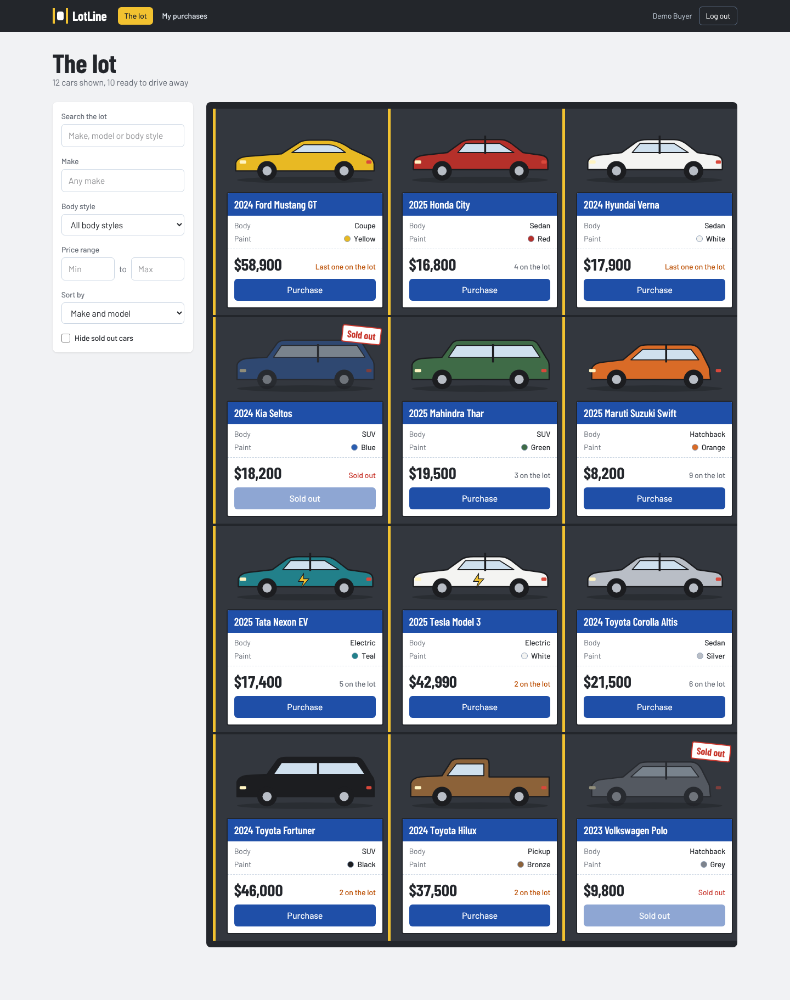
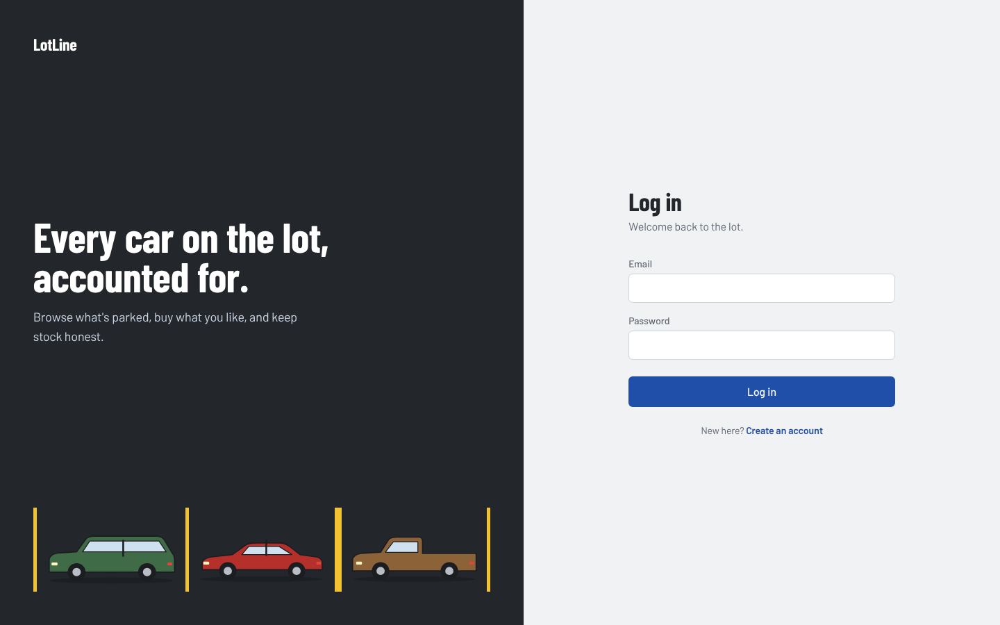
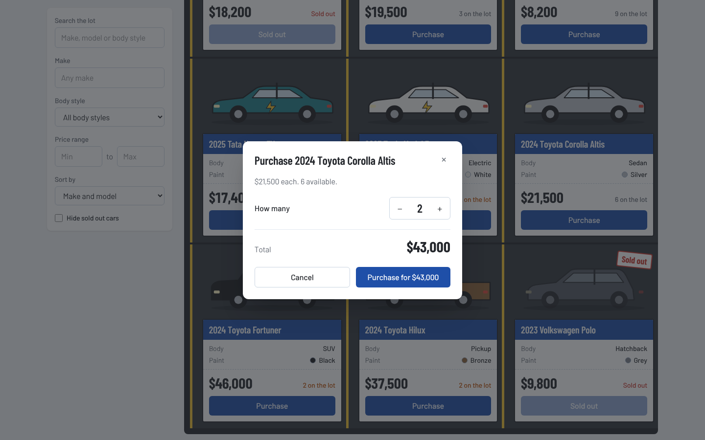
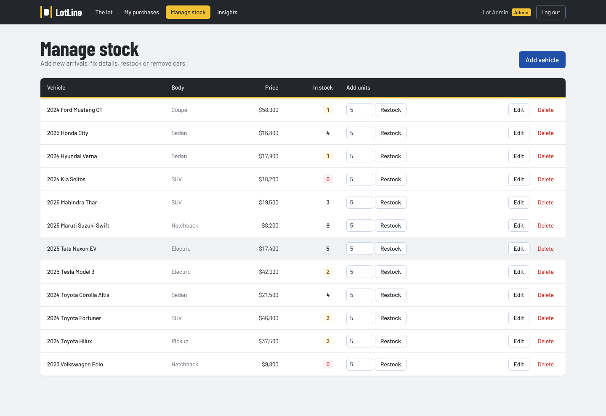
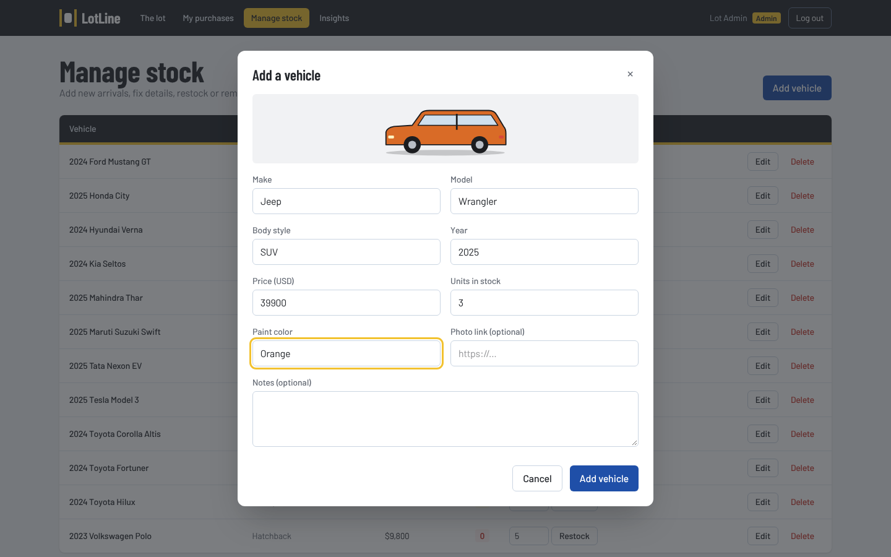
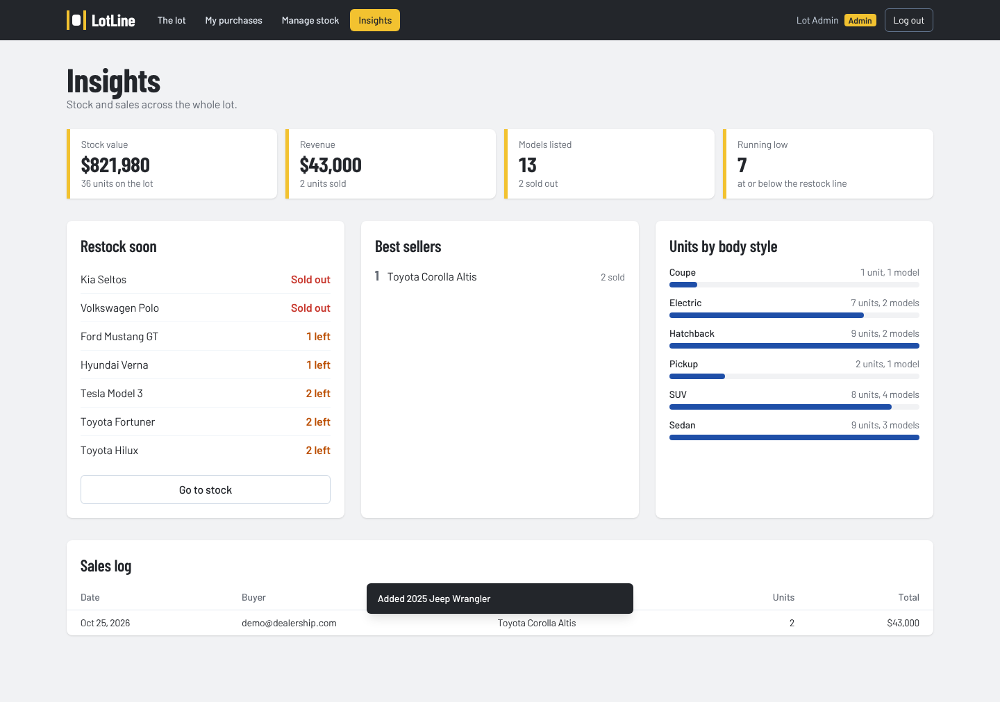
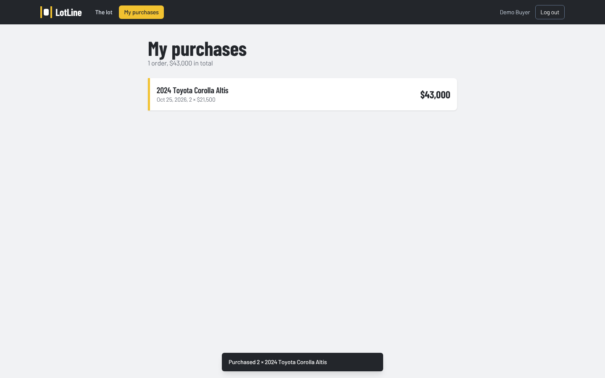
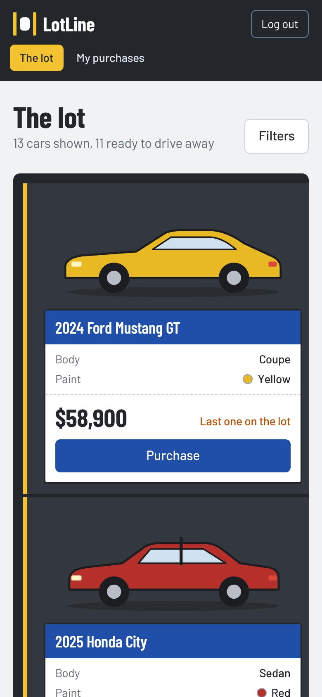

# LotLine: Car Dealership Inventory System

LotLine is a full stack app for running the inventory of a small car dealership. Buyers sign up, browse what's on the lot, filter it down and buy a car. Admins add new arrivals, fix details, restock and remove cars, and get a quick picture of stock and sales.

I built it for the TDD kata, so the backend was written test first and the commit history follows red, green, refactor.

Live demo: https://car-dealership-project-9uz4.vercel.app/ (see [DEPLOY.md](DEPLOY.md))_



## What it does

Required by the kata:

- Register and log in with JWT based auth
- Browse every car on the lot, including sold out ones
- Search by make, model, body style and price range
- Purchase button on each car, disabled when stock hits zero
- Admins can add, edit and delete cars and restock them
- Data lives in a real database (SQLite locally, PostgreSQL in production)

Things I added on top:

1. **Purchase history.** Every sale is saved with the price paid at that moment. Buyers get a "My purchases" page, admins get a full sales log with the buyer's email. History stays correct even if the car is later edited or deleted.
2. **Insights page for admins.** Stock value, revenue, units sold, a "restock soon" list, best sellers and a units per body style chart, all worked out with SQL aggregates.
3. **Better buying and browsing.** You can buy more than one unit with a live total, sort the lot five ways, hide sold out cars, and cars with one or two left are flagged.
4. **Stock can't go negative under load.** The stock check happens inside the SQL `UPDATE`, so two people clicking buy on the last car at the same time can't both get it.
5. **Demo data.** One command (or one env var on the server) fills the lot with a dozen cars and two demo accounts.

## Tech stack

| Part | Choice |
| --- | --- |
| Backend | Python 3.12, FastAPI, SQLAlchemy 2 |
| Database | SQLite for local dev and tests, PostgreSQL in production |
| Auth | JWT (PyJWT), passwords hashed with PBKDF2-SHA256 |
| Backend tests | pytest, pytest-cov, FastAPI TestClient |
| Frontend | React 19, Vite, Tailwind CSS 4, plain HTML5/CSS3 |
| Frontend tests | Vitest |
| CI / hosting | GitHub Actions for tests, Vercel (frontend + API), Neon (PostgreSQL) |

## Project layout

```
backend/
  app/
    main.py            app factory, middleware, routers
    config.py          settings read from env vars
    models.py          User, Vehicle, Purchase tables
    schemas.py         request and response models
    security.py        password hashing and JWT
    deps.py            db session, current user, admin check
    errors.py          domain errors and how they map to HTTP
    routers/           thin HTTP layer
    services/          business logic (auth, vehicles, inventory, purchases, stats)
    seed.py            demo data
  tests/               101 tests, one file per area
frontend/
  src/
    api/client.js      fetch wrapper
    context/           auth and toast state
    pages/             lot, purchases, manage stock, insights, login
    components/        cards, dialogs, forms, the SVG car drawings
    lib/               small pure helpers (tested)
  tests/
api/
  index.py           entry point Vercel uses to run the backend
docs/
  screenshots/
  test-report.txt
```

Routers only deal with HTTP. Services hold the rules and don't import FastAPI at all, they raise plain errors like `NotFoundError` or `OutOfStockError` and one handler turns those into status codes. Each service gets its session handed in, which keeps them easy to test and swap.

## Running it locally

You need Python 3.11+ and Node 20+.

### 1. Backend

```bash
cd backend
python -m venv .venv
source .venv/bin/activate        # on Windows: .venv\Scripts\activate
pip install -r requirements.txt

# optional, fills the lot with demo cars and two accounts
python -m app.seed

uvicorn app.main:create_app --factory --reload
```

The API runs on http://localhost:8000 and the interactive docs are at http://localhost:8000/docs.

Settings come from environment variables. Defaults are fine for local work, see `backend/.env.example` for the full list:

| Variable | What it does | Default |
| --- | --- | --- |
| `DATABASE_URL` | SQLAlchemy URL. `postgres://` URLs are fixed up automatically | `sqlite:///./dealership.db` |
| `JWT_SECRET` | Signs tokens. Set a long random value in production | dev value |
| `TOKEN_MINUTES` | How long a login lasts | `120` |
| `ADMIN_EMAILS` | Comma separated. These emails become admins when they register | empty |
| `CORS_ORIGINS` | Comma separated frontend origins allowed to call the API | `http://localhost:5173` |
| `LOW_STOCK_THRESHOLD` | Stock at or under this counts as low | `2` |
| `SEED_DEMO_DATA` | `true` seeds demo data when the server starts | off |
| `SEED_PASSWORD` | Password for the two demo accounts | `admin123` |

### 2. Frontend

In a second terminal:

```bash
cd frontend
npm install
npm run dev
```

Open http://localhost:5173. If your API isn't on port 8000, copy `.env.example` to `.env` and change `VITE_API_URL`.

### Demo accounts (after seeding)

| Email | Password | Role |
| --- | --- | --- |
| admin@dealership.com | admin123 | Admin |
| demo@dealership.com | admin123 | Buyer |

You can also register your own account. To make yourself an admin, put your email in `ADMIN_EMAILS` before registering.

## API

All vehicle and purchase routes need an `Authorization: Bearer <token>` header.

| Method | Path | Who | What |
| --- | --- | --- | --- |
| POST | `/api/auth/register` | anyone | Create account, returns token and user |
| POST | `/api/auth/login` | anyone | Returns token and user |
| GET | `/api/auth/me` | logged in | Current user |
| GET | `/api/vehicles` | logged in | Every vehicle |
| GET | `/api/vehicles/search` | logged in | Filter with `make`, `model`, `category`, `q`, `min_price`, `max_price`, `in_stock`, `sort` |
| GET | `/api/vehicles/categories` | logged in | Distinct body styles for the filter dropdown |
| GET | `/api/vehicles/{id}` | logged in | One vehicle |
| POST | `/api/vehicles` | admin | Add a vehicle |
| PUT | `/api/vehicles/{id}` | admin | Partial update |
| DELETE | `/api/vehicles/{id}` | admin | Delete |
| POST | `/api/vehicles/{id}/purchase` | logged in | Body `{"quantity": n}` is optional, defaults to 1 |
| POST | `/api/vehicles/{id}/restock` | admin | Body `{"quantity": n}` |
| GET | `/api/purchases/me` | logged in | Your purchase history |
| GET | `/api/purchases` | admin | Every sale with buyer email |
| GET | `/api/stats/summary` | admin | Numbers for the insights page |

Errors always come back as `{"detail": "..."}`. Status codes: 401 not logged in, 403 not an admin, 404 not found, 409 duplicate email or not enough stock, 422 bad input, 400 for an impossible price range.

One choice worth calling out: the kata only marks delete and restock as admin only. I made add and update admin only too, because a dealership where any customer can change prices or add cars didn't make sense. It's a one line change in `routers/vehicles.py` if that's not wanted.

## Tests

```bash
cd backend
pytest -v --cov=app
```

```bash
cd frontend
npm test
```

Current result: **101 backend tests passing, 100% line coverage** on the `app` package. The full output is in [docs/test-report.txt](docs/test-report.txt).

| File | What it checks |
| --- | --- |
| `test_security.py` | hashing round trip, unique salts, expired and forged tokens |
| `test_auth.py` | register, login, duplicate emails, validation, admin list, `/me` |
| `test_vehicles.py` | CRUD, validation, admin vs regular user, 404s |
| `test_search.py` | each filter, combined filters, price range rules, sorting |
| `test_inventory.py` | purchase and restock, sold out, over buying, permissions |
| `test_purchases.py` | history, price snapshot, privacy between users, survives delete |
| `test_stats.py` | every number on the insights page |
| `test_seed.py`, `test_config_and_edges.py`, `test_vercel_entry.py` | seeding, env parsing, the Vercel entry point, leftover edge cases |

Each test gets its own throwaway SQLite file, so tests never share state.

The frontend tests cover the pure helpers (query string building, price range checks, formatting). The pages themselves I checked by hand and with a headless browser run through register, search, buy, add a car and the insights page.

## Screenshots

API testing screenshots are attached in the [API_testing_screenshots](API_testing_screenshots/) folder.


| | |
| --- | --- |
|  |  |
| Login | Buying two units |
|  |  |
| Manage stock (admin) | Add vehicle form with live preview |
|  |  |
| Insights (admin) | Purchase history |



## Design notes

The look is based on an actual car lot: asphalt grey, yellow painted bay lines between the cars, and each car card laid out like the price sticker you see in a car window. Type is Barlow, which was drawn from California highway and license plate lettering. The cars are simple hand-coded SVG side profiles, one per body style, and they take on the paint color you enter, so the app needs no stock photos. An admin can still add a photo link per car if they want.

## Hosting

The whole app runs on Vercel's free plan. The React build is served as a static site and the FastAPI app runs as a Python function from `api/index.py`, so both live on one address and there's no CORS to configure. The database is a free Neon PostgreSQL instance. Every push to `main` redeploys. Step by step instructions are in [DEPLOY.md](DEPLOY.md).

## My AI Usage

### Tools

- **Claude (Anthropic)**, used through the Claude app.

### How I used it

- I gave Claude the kata brief and had it work through the backend test first: it wrote the failing tests for each area, then the code to pass them, then the refactors. The commit history shows that order.
- It proposed the overall structure (app factory, services separated from routers, domain errors) and I kept it because it made testing easy.
- It wrote most of the React frontend, the Tailwind theme and the SVG car drawings, and ran the app in a headless browser to take the screenshots.
- It flagged a race condition in the first version of purchase (read stock, check, write) and changed it to an atomic `UPDATE ... WHERE quantity >= n`.
- It set up the GitHub Actions test workflow and the Vercel deployment config.


## References

- [FastAPI](https://fastapi.tiangolo.com/)
- [SQLAlchemy](https://docs.sqlalchemy.org/)
- [Vite](https://vite.dev/)
- [Vercel – Python runtime](https://vercel.com/docs/functions/runtimes/python)
- [Vercel – vercel.json configuration](https://vercel.com/docs/project-configuration)
- [Neon – Connect from any app](https://neon.tech/docs/connect/connect-from-any-app)
- [psycopg 3](https://www.psycopg.org/psycopg3/docs/)

## AI Usage

Every commit that used AI has a `Co-authored-by` trailer for Claude. The raw chat is linked in [PROMPTS.md](PROMPTS.md).
  
### Reflection

The main job was of this project was creating application, reviewing it, running it, and making sure I understand every decision well enough to explain and change it. Working test first with an AI was useful because the tests made it obvious when generated code was wrong, and they gave me something concrete to read before the implementation. The biggest time saver was boilerplate (schemas, routers, forms). The parts I had to think hardest about were the rules: who is allowed to do what, what happens to history when a car is deleted, and how to stop stock going negative.
